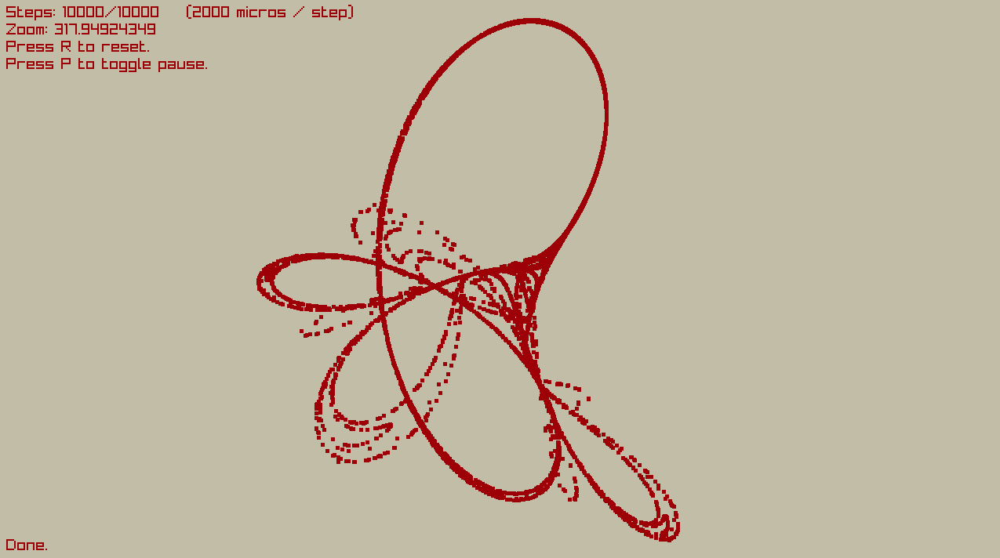

# Tinkerbell Map

A [Tinkerbell map](https://en.wikipedia.org/wiki/Tinkerbell_map) renderer written in Rust with [raylib](https://github.com/deepch/raylib-rs).



Tinkerbell map is a discrete chaotic system that iterates a single point:

```
x' = x² - y² + a·x + b·y
y' = 2·x·y + c·x + d·y
```

Its final shape look quite nice, for some reason.

## Controls

| Key                  | Action                          |
| -------------------- | ------------------------------- |
| `P`                  | Toggle pause                    |
| `R`                  | Reset                           |
| `Mouse wheel`        | Zoom in/out                     |
| `Up`, `Down`         | Zoom in/out                     |
| `Ctrl` + zoom        | Finer zoom steps                |
| `Esc`, `Q`           | Quit                            |

## Build and run

With Nix:

```sh
nix-shell
cargo run --release
```

Without Nix, install a Rust toolchain plus the raylib build dependencies (cmake, libclang, X11/GL dev libraries, etc.), then run `cargo run --release`.

## Configuration

Constants at the top of `src/main.rs`:

| Constant                               | Meaning                                  |
| -------------------------------------- | ---------------------------------------- |
| `TOTAL_STEPS`                          | Number of iterations to compute          |
| `STEP_INTERVAL_MC`                     | Microseconds between each step           |
| `INITIAL_ZOOM_LEVEL`                   | Zoom at startup and after reset          |
| `MIN_ZOOM`, `MAX_ZOOM`                 | Zoom limits                              |
| `SQUARE_BASE_SIZE`                     | Size of each drawn point                 |
| `X_OFFSET`, `Y_OFFSET`                 | Shift of the drawing on screen           |
| `BACKGROUND_COLOR`, `FOREGROUND_COLOR` | Drawing colors                           |
